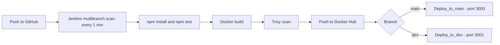

# CI/CD Pipeline with Jenkins, Docker and GitHub

A multibranch Jenkins pipeline that builds, tests, scans and publishes a Node.js (React) app as a Docker image. It then deploys the image to separate `main` and `dev` environments.

## Architecture

## Tech stack

Jenkins, Docker, Docker Hub, GitHub, Node.js / npm, Trivy, Jenkins Shared Library, Role-based Authorization Strategy. Everything runs on an Ubuntu VM in VirtualBox.

## Pipelines

| Job | Type | Purpose |
|-----|------|---------|
| `CICD` | Multibranch | On each commit to `main` or `dev`: install, test, build image, scan, push, trigger deploy |
| `Deploy_to_main` | Pipeline | Pulls `nodemain:v1.0` from Docker Hub and runs it on port 3000 |
| `Deploy_to_dev` | Pipeline | Pulls `nodedev:v1.0` from Docker Hub and runs it on port 3001 |
| `CD_deploy_manual` | Parameterized pipeline | Manual deploy of a chosen environment (`BRANCH`) and image tag (`IMAGE_TAG`) |

### CICD stages
1. **Build:** `npm install`
2. **Test:** `npm test` (a failure stops the pipeline)
3. **Docker Build:** `docker build -t <nodemain|nodedev>:v1.0 .`
4. **Trivy Scan:** reports known vulnerabilities in the image
5. **Push:** pushes the image to Docker Hub using stored Jenkins credentials
6. **Trigger Deploy:** starts `Deploy_to_main` or `Deploy_to_dev` depending on the branch

The same `Jenkinsfile` is used on both branches. The branch name selects the image name and port.

## Key features

- **Branch-based environments:** `main` on port 3000 and `dev` on port 3001.
- **Automatic branch discovery:** the multibranch job scans the repo every minute.
- **Low-downtime deploys:** the new image is built or pulled first. Only then is the old container removed and the new one started.
- **Shared library:** `deployContainer` (in `vars/`) holds the pull, remove and run logic and is reused by both deploy jobs. Library repo: `[jenkins-shared-lib](https://github.com/obsessed456/jenkins-shared-lib)`
- **Role-based access:** `devops` (full control), `dev` (run jobs) and `qa` (read logs only).
- **Secrets management:** the Docker Hub token is stored in Jenkins Credentials, never in the repo.

## Setup summary

1. Install Jenkins, Docker, Node.js (via the NodeJS plugin) and Trivy on the VM.
2. Add the `jenkins` user to the `docker` group.
3. Configure the NodeJS tool in **Manage Jenkins → Tools** with the name `node`.
4. Add a `dockerhub` credential (username and access token).
5. Register the shared library under **Manage Jenkins → System** (name `jenkins-shared-lib`, default version `main`).
6. Create the `CICD` multibranch job pointing at this repo, and set it to scan every minute.
7. Create `Deploy_to_main`, `Deploy_to_dev` and `CD_deploy_manual`.

## Screenshots

| | |
|---|---|
| Jenkins dashboard | `docs/images/dashboard.png` |
| CICD branches | `docs/images/branches.png` |
| App on `main` (:3000) | `docs/images/app-main.png` |
| App on `dev` (:3001) | `docs/images/app-dev.png` |

## Challenges and fixes

| Problem | Cause | Fix |
|---------|-------|-----|
| Jenkins would not start | Port 8080 was already in use (`BindException`) | Set `JENKINS_PORT=8081` in a systemd override, with the `[Service]` header |
| Override ignored | Missing `[Service]` section in `override.conf` | Added the header, then ran `daemon-reload` |
| Manual deploy always picked `nodedev` | `BRANCH_NAME` exists only in multibranch jobs | Used `params.BRANCH` in the manual job |
| `docker tag` failed with "No such image" | Source image was missing its `:v1.0` tag | Tagged `$IMAGE:v1.0` explicitly |
| Port already allocated | Containers were started without `--name`, so they were never removed | Added `--name` and `docker rm -f` |
| Scan and build failed with empty git objects | Corrupted Jenkins git cache and workspace | Deleted the cache and workspace folders and re-ran |
| Shared library "No version specified" | No default version configured | Set the default version to `main` |

## What I learned

- How multibranch pipelines discover and build branches.
- The difference between CI (build and test) and CD (deploy), and why images are published to a registry.
- Writing declarative pipelines with environment variables, credentials and branch conditions.
- Reusing pipeline code through Jenkins Shared Libraries.
- Adding basic security checks (Trivy) and access control (role-based permissions).

## Possible improvements

- Use webhooks instead of polling.
- Tag images with the build number or commit hash instead of a fixed `v1.0`.
- Fail the build on high or critical vulnerabilities (`--exit-code 1`).
- Deploy to a separate server instead of the Jenkins VM.
- Manage Jenkins settings with Configuration as Code (JCasC).
